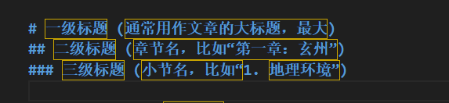

# Markdown 使用教程

## 1. 标题 (控制字号大小)

就像写大纲一样，用井号 “#” 的数量来决定层级。
语法：`#` + 空格 + 文字
示例：

效果：


## 2. 换行与段落

在 Markdown 里，直接按一下回车**不叫换行**，叫空格。

### 🅰️ 想要分段 (段落之间有空隙)

**操作**：按 **两次** 回车（中间空一行）。
**场景**：写小说时的自然分段。

> **效果演示**：
>
> 这是第一段话。
>
> 这是第二段话，你看，中间有一条缝。

### 🅱️ 想要紧凑换行 (行与行挨着)

**操作**：在上一行末尾敲 **两个空格**，再按回车。
**场景**：写诗、歌词、或者紧凑的列表。

> **效果演示**：
>
> 这里的山路十八弯 (末尾有两个空格)  
> 这里的水路九连环

## 3. 代码块 (固定格式类似pdf)

让你的命令和代码像程序员文档一样显示在“灰色方框”里，保留格式，不会乱跑。

### 1. 单行代码 (穿插在文字里)

**语法**：用两个反引号 ` 把内容包起来。
**效果**：输入 `pip install` 就可以安装。

### 2. 多行代码块 (一整段配置)

**语法**：在首尾各写 **三个反引号**

````markdown
bash
git init
git add .
git commit -m "第一次提交"
````
(注：反引号 ` 通常在键盘左上角 Esc 键的下面，一定要用**英文输入法**打)
## 4. 特殊格式

### 无序列表 (小圆点)

语法：用减号 `-` 或星号 `*` 加空格。

- 记得买菜
- 记得写日记

### 有序列表 (数字)

语法：直接写 `1.` 加空格。

1. 第一步
2. 第二步

### 引用 (给自己留的话)

如果你想对某段话做个高亮，或者引用别人的名言。
语法：`>` + 空格

> 这是一个引用的样式

## 5. 引入图片

**a. 存放图片 (关键步骤)**

MkDocs 只能识别放在 `docs` 文件夹内的资源。建议你保持目录整洁，按以下结构存放：

1. 打开你的项目文件夹。
2. 进入 `docs` 文件夹。
3. 新建一个文件夹命名为 `images`（或 `assets`）。
4. 将你的图片（例如 `photo.jpg`）放入这个 `docs/images` 文件夹中。

```markdown

```
## 6. 强调 (加粗与斜体)

写小说设定时，总有些关键词需要醒目一点。

- **加粗**：用两个星号包裹。
    - 语法：`**重点文字**`
    - 效果：**重点文字**
- *斜体*：用一个星号包裹（通常用于内心独白或特殊术语）。
    - 语法：`*内心独白*`
    - 效果：*内心独白*
- ~~删除线~~：用两个波浪号包裹（用于吐槽或废弃的旧设定）。
    - 语法：`~~旧设定~~`
    - 效果：~~旧设定~~

## 7. 超链接 (跳转)

MkDocs 的核心优势就是可以互相跳转。

- **外部链接** (跳转到百度/谷歌)：
    - 语法：`[名称](网址链接)` 或 `[百度一下](https://www.baidu.com)`
    - 效果：[百度一下](https://www.baidu.com)

- **内部链接** (跳转到你自己的其他文档)：
    - 语法：`[名称](文档名称)` 或 `[python学习跳转](python_study.md)`
    - 效果：[python学习跳转](python_study.md)
    - *(注：括号里写你 docs 文件夹下的文件名，支持相对路径)*

## 8. 表格 (二维表格)

虽然 Markdown 的表格语法看起来有点麻烦。

**语法结构：**

```markdown
| 角色名 | 门派 | 境界 |
| :--- | :--- | :--- |
| 张三 | 玄天宗 | 筑基期 |
| 李四 | 散修 | 金丹期 |
```

**语法效果：**

| 角色名 | 门派 | 境界 |
| :--- | :--- | :--- |
| 张三 | 玄天宗 | 筑基期 |
| 李四 | 散修 | 金丹期 |

*(注意：第二行的 `| :--- |` 是必须的，用来分割表头)*

## 9. 提示块 / Admonitions (MkDocs 的魔法 ✨)

这是 MkDocs 主题（Material Theme）最漂亮的功能，能生成带颜色和图标的提示框，非常适合写“注意事项”或“备注”。

**语法**：(三个感叹号 + 空格 + 类型)

!!! note "备注"
    这里是备注的内容，前面必须缩进（按Tab键或4个空格）。
    如果不缩进，框框就会断掉，变成普通文字。

!!! warning "警告"
    这是一个警告框，颜色通常是黄色的。

*(常用类型还有：`info` 蓝色, `success` 绿色, `tip` 青色, `failure` 红色)*

---

### 如何开启“魔法”功能

MkDocs 默认不开启这个功能，你需要去“总控室” `mkdocs.yml` 里手动把开关打开。

**1. 打开 mkdocs.yml 文件**
找到你项目根目录下的 `mkdocs.yml` 文件。

**2. 粘贴配置代码**
你需要添加一个 `markdown_extensions` 模块。请把下面这段代码完整复制，粘贴到 `mkdocs.yml` 的最末尾：

```yaml
markdown_extensions:
  - admonition
  - pymdownx.details
  - pymdownx.superfences
```
**3. ⚠️ 重要：重启服务**
修改配置文件（`mkdocs.yml`）后，正在运行的预览通常不会自动更新配置。

1. 在你的终端/黑框框里，按 `Ctrl + C` 停止当前的运行。
2. 重新输入 `mkdocs serve` 并回车。
3. 再次刷新你的网页，那个漂亮的方框应该就出现了！


## 10. 代码框高级显示 (顶部标题栏)

让代码块顶部出现一个“文件标题栏”，看起来像是一个独立的文件窗口，非常专业。

### 🅰️ 核心语法

**语法规则**：在三个反引号后面写 `语言名称`，然后空格，写 `title="标题内容"`。

**1. 语法 (你应该这样写):**

````markdown
```python title="main.py"
print("Hello World")
```
````

**2. 效果 (网页上会这样显示):**

```python title="main.py"
print("Hello World")
```

---

### 🅱️ 更多场景示例

#### 示例 1: Python 脚本

**语法:**
````markdown
```python title="爬虫脚本.py"
import requests

def get_html(url):
    return requests.get(url).text
```
````

**效果:**
```python title="爬虫脚本.py"
import requests

def get_html(url):
    return requests.get(url).text
```

#### 示例 2: Markdown 文档

**语法:**
````markdown
```markdown title="示例文档.md"
# 这是一个标题
这里是正文内容...
```
````

**效果:**
```markdown title="示例文档.md"
# 这是一个标题
这里是正文内容...
```

#### 示例 3: 终端命令 (Bash)

**语法:**
````markdown
```bash title="安装命令"
pip install mkdocs-material
```
````

**效果:**
```bash title="安装命令"
pip install mkdocs-material
```

---

### ⚠️ 注意事项 (配置检查)

要让 `title="..."` 这个漂亮的标题栏生效，请确保你的 `mkdocs.yml` 里面已经开启了 `superfences` 插件：

```yaml title="mkdocs.yml"
markdown_extensions:
  - pymdownx.superfences  # ✅ 核心：支持高级代码框和标题栏
  - pymdownx.highlight:   # ✅ 上色：代码高亮
      anchor_linenums: true
```