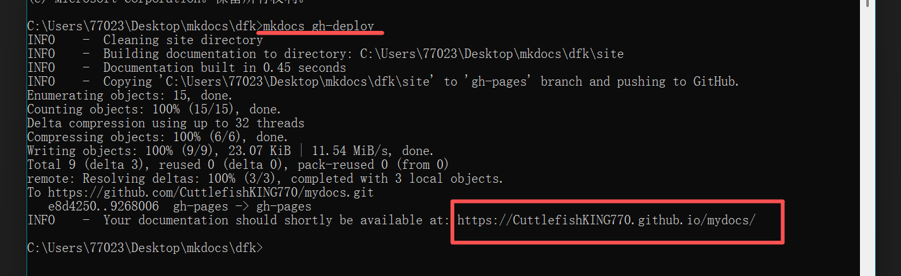
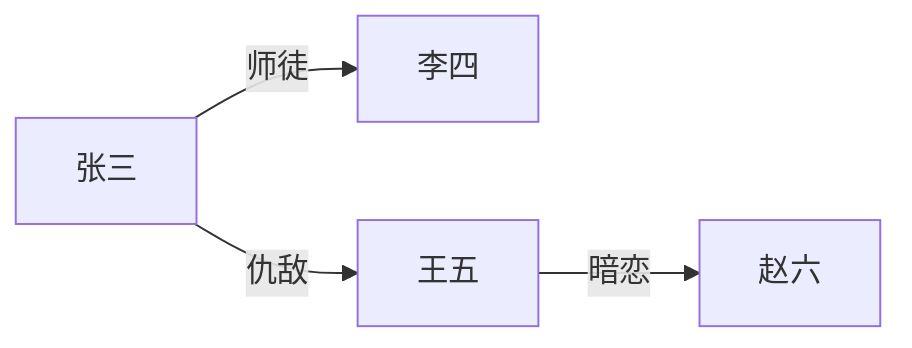
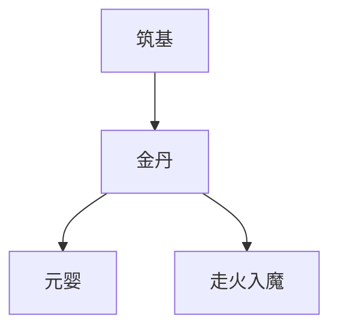

# MkDocs 搭建与维护自查手册

## 1. 核心命令 (搭建篇)

* **安装工具**：  
`pip install mkdocs`  
`pip install mkdocs-material` （新uI）  
* **新建项目**：  
 选择一个文件夹，在地址栏输 CMD 打开黑框。  
 输入：`mkdocs new  文件名  （或者在当前目录用 `mkdocs new .`）

* **启动预览 (本地)**：  
**注意**：必须先进目录！输入 `cd 文件夹名`。
*输入：`mkdocs serve` （这一步叫“本地预览”，关掉黑框网页就没了）  
浏览器访问：`http://127.0.0.1:8000`


## 2. 如何修改内容 (装修篇)
* **写文章**：
修改 `docs/index.md` 文件（记事本打开，写什么显示什么）。  
*如果要加新页面，就在 docs 里新建 .md 文件。*  
* **改配置**：
修改 `mkdocs.yml` 文件。
* 改名：找 `site_name`。
* 换皮肤：在里面加上 `theme: name: material`。


## 3. 首次发布到互联网 

### a. **去 GitHub 建立文件**：
在网页上 New Repository，名字填好，创建。
### b. **本地连接**：
在项目文件夹的 CMD 里依次输入：
```bash
git init
git add .
git commit -m "first commit"
git branch -M main
git remote add origin https://github.com/你的ID/仓库名.git
mkdocs gh-deploy

```


### c. **开启网页 (如果无法执行网页)**:  
(1). 去 GitHub 仓库 -> **Settings** -> **Pages**。  
(2).  把 **Branch** 改成 `gh-pages`，点击 **Save**。  
(3). 等待 1-2 分钟，刷新页面。  

## 4. 日常更新流程 (以后每天都看这里)

**以后写日记，只需要做这 3 步，不需要再 git init 了！**

1. **改**：在电脑里写好 `index.md` 或新日记，保存。
2. **发**：在项目文件夹打开 CMD，输入这一句“发射命令”：
```bash
mkdocs gh-deploy
```
3. **看**：等待黑框跑完，去浏览器刷新你的网址。





##  进阶玩法


    
