# 承载网 / OLT 维护笔记

> **发布说明**：本页为公开站点，文中所有系统登录口令已替换为`<密码已隐藏>`。完整口令保存在本地原始文档中，不随本页发布。

> 本文档由原《笔记831.docm》整理合并而成。整理时做了三件事：
> 1. **重排章节**：原文编号混乱（一、二、四、五、八与 1/2/3/5/6/7 混用，"三"缺失），现统一为一～九章，节号连续；
> 2. **修正错漏**：统一了错别字与命令拼写（`dispaly`→`display`、"魔板"→"模板"、"案列"→"案例"、"comit"→`commit`、"sw vlan"→`switchport vlan` 等），并把原文档里只有截图、没有文字的步骤补成了可读的操作说明；
> 3. **归位插图**：原文共 204 张内嵌图，其中 2 组是同一截图的重复拷贝，去重后 **202 张全部保留**，按内容就近插入，图注说明该图在看什么。

---

## 目录

- [第一章 BAS（宽带接入服务器）](#第一章-bas宽带接入服务器)
- [第二章 IDC 设备（CE16808 / 中兴 9908）](#第二章-idc-设备ce16808中兴-9908)
- [第三章 互联网专线](#第三章-互联网专线)
- [第四章 OLT](#第四章-olt)
- [第五章 号线系统](#第五章-号线系统)
- [第六章 账号与网站汇总](#第六章-账号与网站汇总)
- [第七章 Python / Pandas 速查](#第七章-python-与-pandas-速查)
- [第八章 IP 备案](#第八章-ip-备案)
- [第九章 实际配置案例](#第九章-实际配置案例)
- [附录：常用命令速查](#附录常用命令速查)

---

## 第一章 BAS（宽带接入服务器）

### 1.1 查询 OLT 的内外标范围

前提：已经拿到 OLT 的 IP，需要确认它挂在哪台 BAS 上、走哪个子接口。

**登录方式**：目前（HW 期间）只能以 VPN + SSH 方式登录。正常期间可用 V5 VPN，在 3A 管理里直接进入。


登录后查路由，定位 OLT 挂在哪个接口：

```
display ip routing-table x.x.x.x        # 此处填 OLT 对应的 IP
```


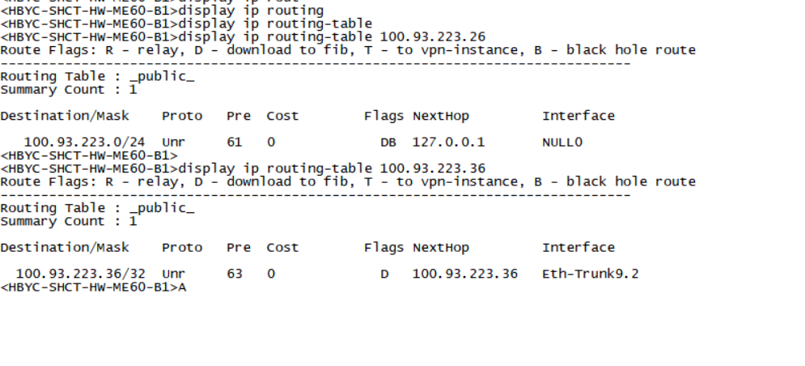

找到 OLT 对应的 Eth-Trunk 口后，先整体看一遍端口描述：

```
display interface description
```

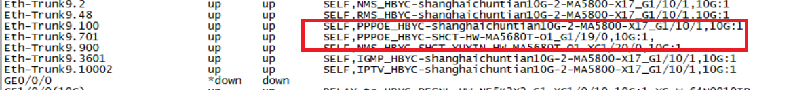

找到 PPOE（自动拨号）那一行的子接口，进去看配置：

```
display current-configuration interface Eth-Trunk xxx.xxx
```

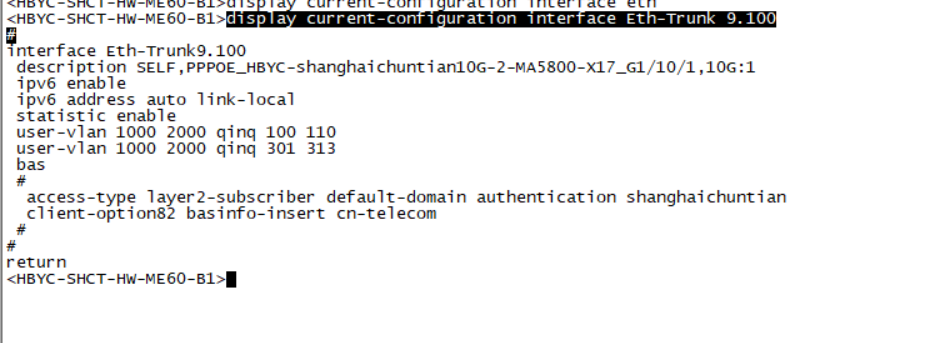

判读规则：

- `qinq` 后面是**外标范围**；
- 上面 `user-vlan` 是**内标范围**；
- 示例图中：内标范围 `1000-2000`，外标范围 `100-110`、`301-313`。

需要看物理口时：

```
interface GigabitEthernet x/x/x
```

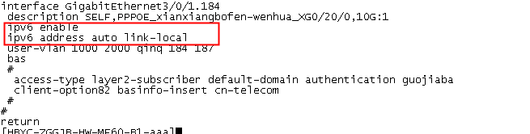

### 1.2 确定 OLT 的 IP

1. 先在**私网地址规划表**中挑选一个未使用的 IP；
2. 进入 BAS，注意提示符：`< >` 是用户模式，`[ ]` 是**管理模式**，只有管理模式才能做数据配置：

```
system
```

![进入管理模式，提示符由 <> 变 []](assets/p0041.png)

3. 配置前再核对一次接口描述，避免配错口：

```
display interface description
```

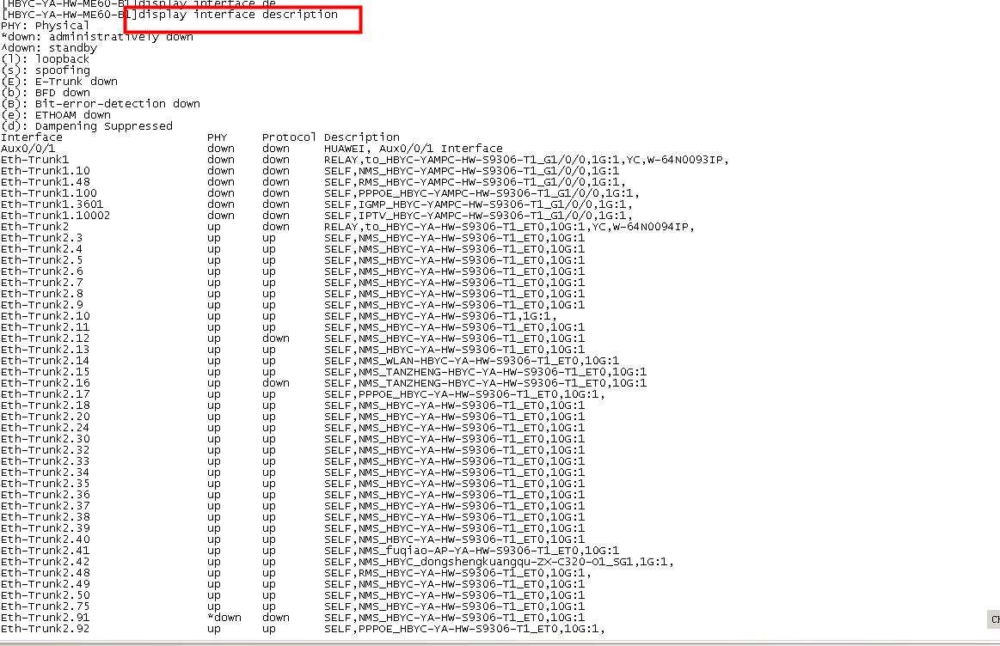

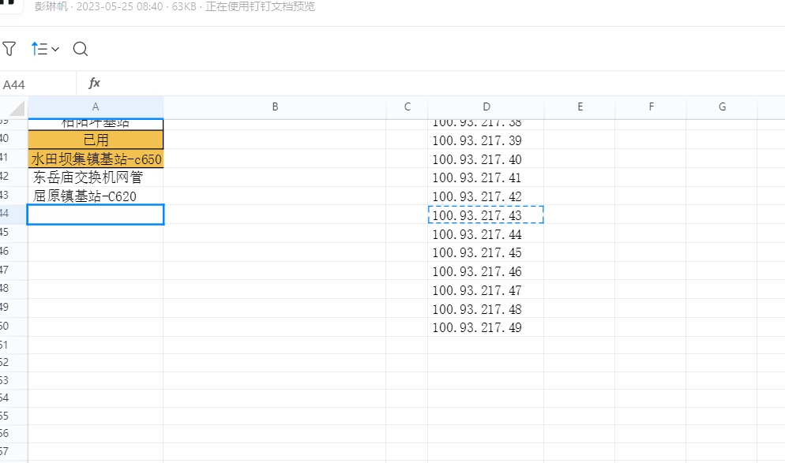

### 1.3 检查有没有 nms-mer 接口

```
display interface description
```

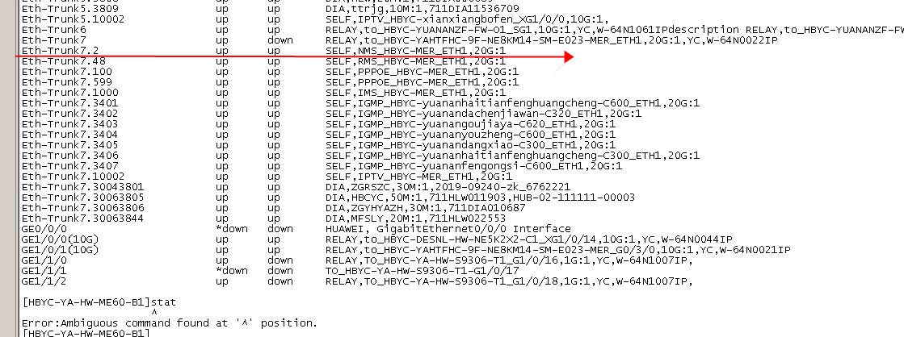

找到可疑的子接口后，确认它下面有没有数据：

```
display current-configuration interface Eth-Trunk7.2
```

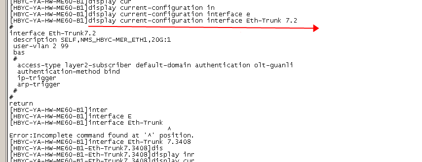

示例配置形态：

```
interface Eth-Trunk7.2
 description SELF,NMS_HBYC-MER_ETH1,20G:1
 user-vlan xxxx 2 99
```

如果该子接口已经规划了**网管 vlan 范围**，就可以直接在这上面绑定网管静态 IP（见 1.8）。

### 1.4 BAS 设备信息与上联板对应关系

**板卡识别**：中兴主控板为 `SMXA`，业务板为 `GTGH`；板卡型号中**带 X 或 B 的是万兆板卡**。

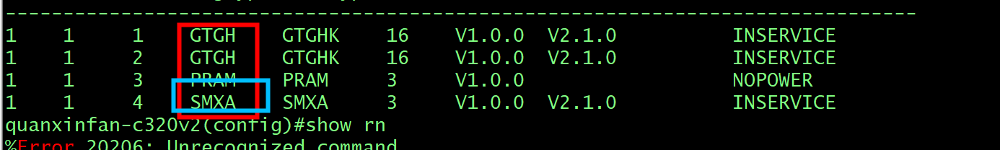

**OLT 上联板与 OLT 型号的对应关系**（查外标时用）：

| OLT 型号 | 上联板端口 |
| --- | --- |
| C620 | `XG1/4/1`、`XG1/5/1` |
| C650 | `XG1/5/1`、`XG1/6/1` |
| 5800x17 | `XG1/8/1`、`XG1/9/1` |
| 5800x15 | `XG1/9/1`、`XG1/10/1` |
| C320 | `XG1/3/1`、`XG1/4/1` |
| C300 | `XG1/19/1`、`XG1/20/1` |

**外标数量**：针对大型 OLT 板卡 —— 5800x17、5800x15、C650、C300、C600，**一台设备有 2 个外标**；其他设备只有 1 个外标（宽带 vlan 依次增加，IPTV 同理）。

### 1.5 六种下挂业务与 BAS 上的简写

一个 OLT 下挂的业务就是这 6 类，BAS 上每个业务一个子接口，靠内外标区分。先记住业务与简写的对应关系，后面看配置才看得懂：

OLT 下挂的 6 种业务：

| 业务 | 说明 |
| --- | --- |
| IPTV | 电视 |
| 宽带 | PPPoE 上网 |
| 语音 | 固定电话 |
| 组播 | IGMP |
| 网管 | 设备纳管 |
| 互联网专线 | DIA |

BAS 配置里出现的简写：

| 简写 | 含义 |
| --- | --- |
| `IGMP` | 组播 |
| `NMS` | 网管 |
| `RMS` | 宽带纳管平台 |
| `IMS` | 有线固话（语音） |
| `PPOE` | 自动上网（拨号宽带） |
| `DIA` | 互联网专线 |

### 1.6 写入错误排查

配错了先看这个 IP 到底被写在什么地方：

```
display current-configuration | include x.x.x.x
```

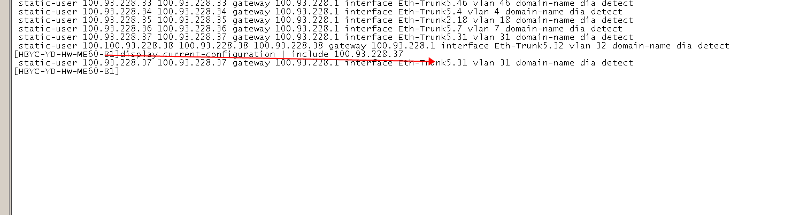

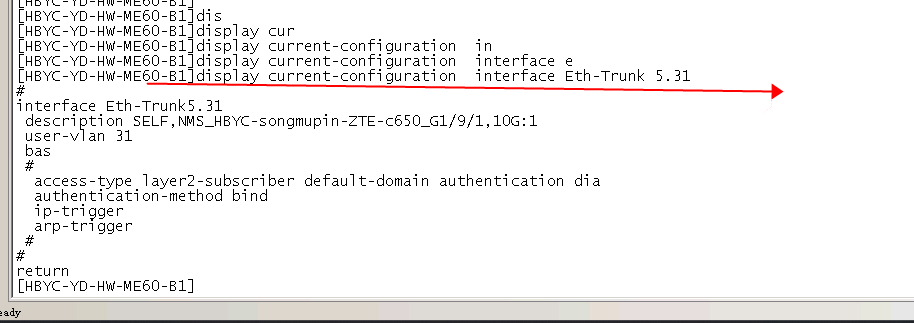

确认是误写（IP 实际未被占用）后，撤回静态 IP 绑定：

```
undo static-user xxxx.xxxx.xxxx.xxxx
```

如果条目是给网管用的（`domain-name olt-guanli`），撤回后网管会立刻掉线，改完要重新绑回。

### 1.7 没有 nms-mer 端口时，如何写网管 vlan

四步：看规划的子接口 → 看规划的网管 vlan → 进网管接口手工写 vlan → 按图配置。

1. 先看之前规划的子接口：


2. 再看规划的网管 vlan：


3. 进入对应的网管接口，手工写入网管 vlan：

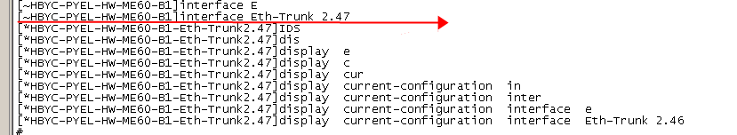

4. 按此图形态配置：

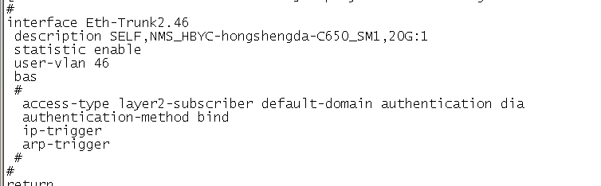

```
interface Eth-Trunk xxx
 description SELF,NMS_HBYC-xxxxxx(基站名称)_SM1,20G:1
 statistic enable
 user-vlan xxx
```

回到 BAS，若出现错误提示，**先敲 `commit` 提交**，再进 BAS 敲下面的命令：

```
access-type layer2-subscriber default-domain authentication dia
authentication-method bind
ip-trigger
arp-trigger
```


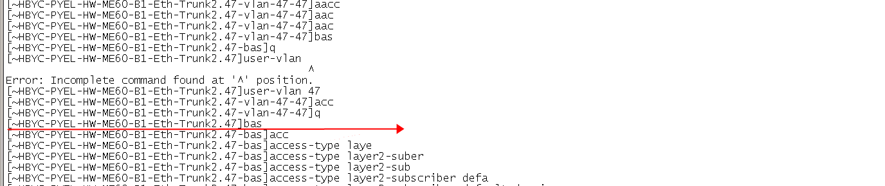
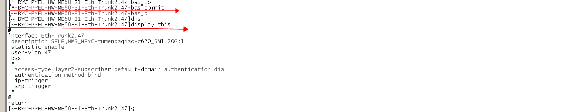

`commit` 确认后，用 `display this` 检查数据是否正常（对照上图第 4 步的形态）。

### 1.8 绑定 / 删除网管静态 IP

绑定（注意 gateway 一般取网段的 `.1`）：

```
static-user <起始IP> <终止IP> gateway <网关> interface Eth-Trunk xxxx(mer接口) \
  vlan xxxx(网管vlan) domain-name olt-guanli detect
```

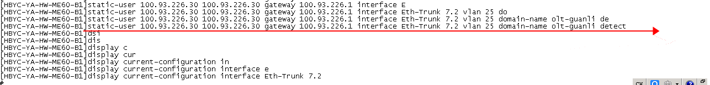

**删除绑定时报"IP 已在线"**，说明用户还挂着，先进 `aaa` 视图把在线用户踢掉：

```
aaa
cut access-user ip-address x.x.x.x
```


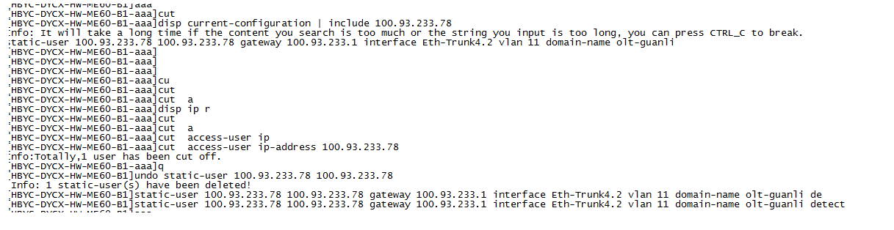

### 1.9 添加组播 vlan

```
interface Eth-Trunk x.xxxx                 # 进入子接口
 vlan-type dot1q xxxx                      # 组播 vlan
 description SELF,IGMP_HBYC-xxxxx(基站名称)-xxxx(设备型号)_ETH1,20G:1
 ip address xxxx(组播IP) 255.255.255.252
 pim sm
 igmp enable
 ip urpf loose
```

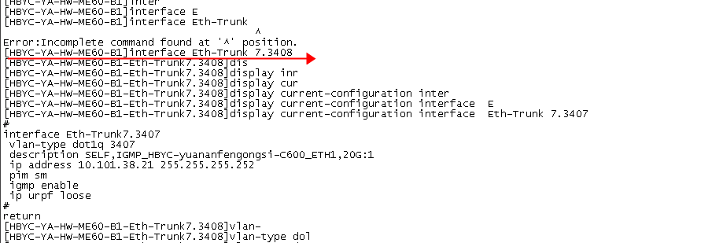


保存：

```
save
y
```


### 1.10 各业务子接口与内标/外标的对应关系

同一台 BAS 上，不同业务用**子接口后缀**区分，务必按后缀认业务：

| 子接口 | 业务 | 说明 |
| --- | --- | --- |
| `.100` | IPv6 | 双栈宽带上行 |
| `.48` | RMS 纳管 | 宽带纳管平台 |
| `.10002` | IPTV | 电视业务 |
| `.1000` | IMS | 有线固话（语音） |
| `.2` | NMS/MER | 网管 |

逐个检查有没有数据：

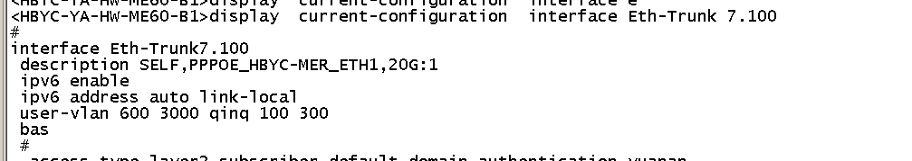

IPv6（`.100`）：

```
interface Eth-Trunk7.100
 description SELF,PPPOE_HBYC-MER_ETH1,20G:1
 ipv6 enable
 ipv6 address auto link-local
 user-vlan 600 3000 qinq 100 300
```

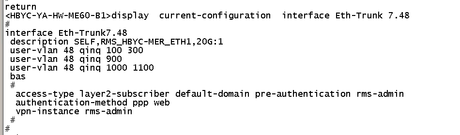

RMS 纳管（`.48`）：

```
interface Eth-Trunk7.48
 description SELF,RMS_HBYC-MER_ETH1,20G:1
 user-vlan 48 qinq 100 300
 user-vlan 48 qinq 900
 user-vlan 48 qinq 1000 1100
```

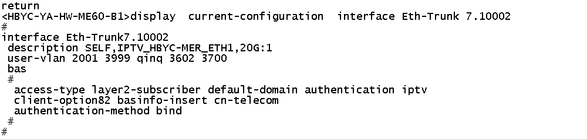

IPTV（`.10002`）：

```
interface Eth-Trunk7.10002
 description SELF,IPTV_HBYC-MER_ETH1,20G:1
 user-vlan 2001 3999 qinq 3602 3700
```

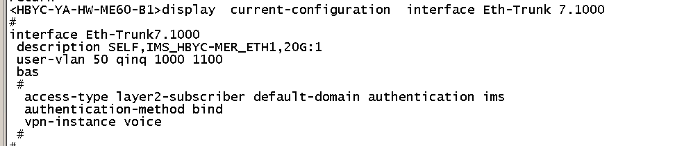

语音（`.1000`）：

```
interface Eth-Trunk7.1000
 description SELF,IMS_HBYC-MER_ETH1,20G:1
 user-vlan 50 qinq 1000 1100
```

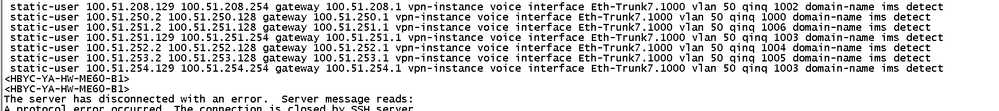

### 1.11 绑定语音 IP

```
static-user <起始IP> <终止IP> gateway <网关> vpn-instance voice \
  interface Eth-Trunk xxxx(语音vlan) vlan 50 qinq <语音外标> domain-name ims detect
```

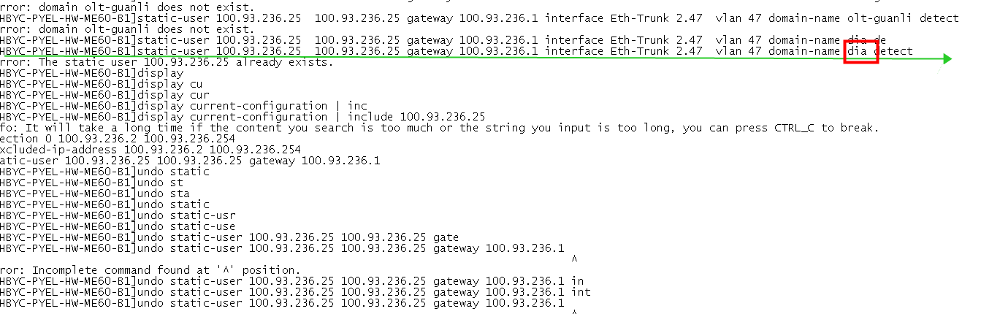

**异常处理**：若提示"静态地址被占用"：


```
display current-configuration | include x.x.x.x      # 查问题 IP 被写在哪
```

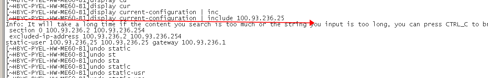

确认只是输入错误、并未真正占用时，直接删掉：

```
undo static-user <起始IP> <终止IP>
```

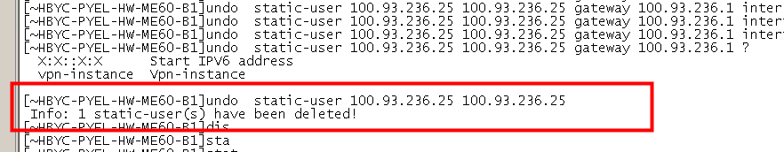

查看 e 口（Eth-Trunk 逻辑口）对应哪个物理接口：

```
display interface brief
```

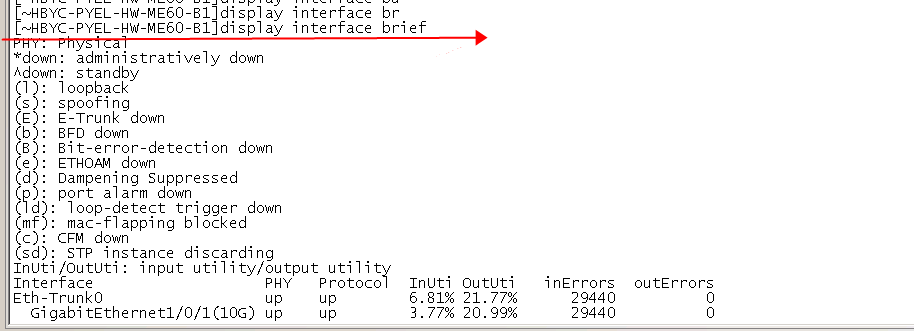

### 1.12 解绑 / 重绑语音 IP（完整流程）

1. 先找该 OLT 归属的 BAS，确认绑定关系：

```
display current-configuration | include x.x.x.x
```

2. 确认没绑过（用群里的地址规划表核对）：


3. **解绑**：先关语音子接口，再删原绑定：

```
interface Eth-Trunk x.900
 shutdown
```

```
undo static-user 100.51.180.221 100.51.180.240 vpn-instance voice
```

4. **重新绑定**：

```
static-user 100.51.180.221 100.51.180.240 gateway 100.51.180.1 vpn-instance voice \
  interface Eth-Trunk4.1000 vlan 50 qinq 1020 domain-name ims detect
```

### 1.13 分配 ONU 的 IP

以给 `100.93.236.18`（夷陵区下坪 C620）分配一个 ONU IP 为例。

先看这个 IP 走哪个子接口：

```
display ip routing-table x.x.x.x        # ONU IP
```

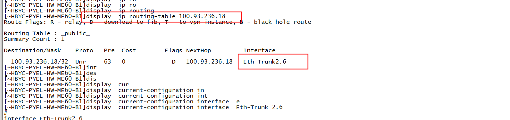

```
display current-configuration interface Eth-Trunk xxx.xxx
```

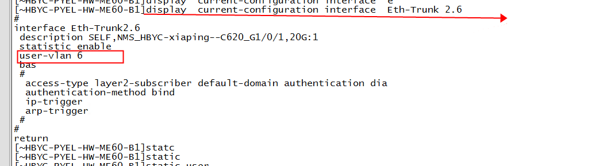

再在私网地址规划表里找未用 IP，填上"已用"：

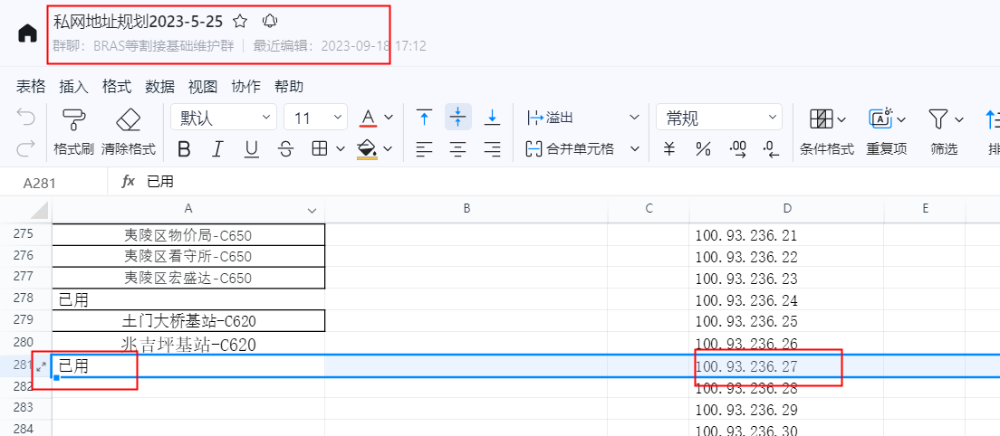

绑定静态地址：

```
static-user <起始IP> <终止IP> gateway <网关> interface Eth-Trunk xxx \
  vlan x domain-name dia detect
```

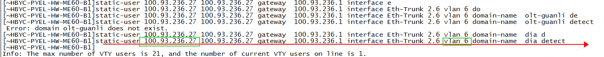

### 1.14 查看接口流量

**专线流量**：先看接口描述找专线口（描述里带 `DIA` 的为专线），直接进接口看数据大小：

```
display interface description
```

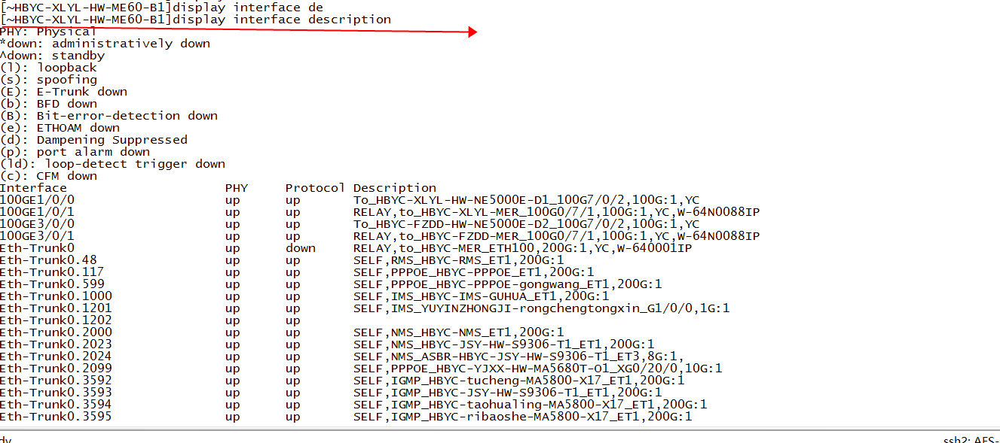


```
display interface Eth-Trunk x.xxx
```

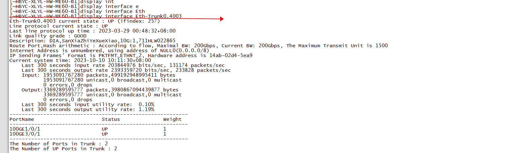

判读：**`output` 是下载（下行），`input` 是上传（上行）**。

### 1.15 查看使用用户数（在线数）

先看对应的拨号 vlan：


再看子接口里哪条是 ppoe：

```
display interface description
```

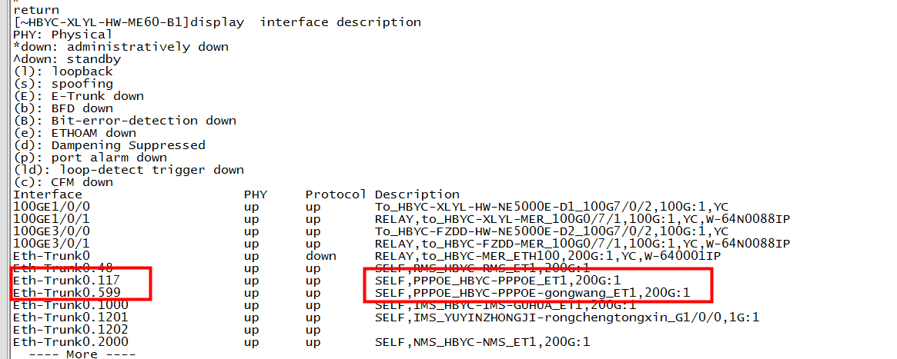

```
display current-configuration interface Eth-Trunk0.117
```

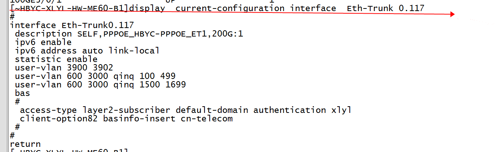

确认是此子接口后，统计在线用户：

```
display access-user interface Eth-Trunk0.117 pevlan 3900
```

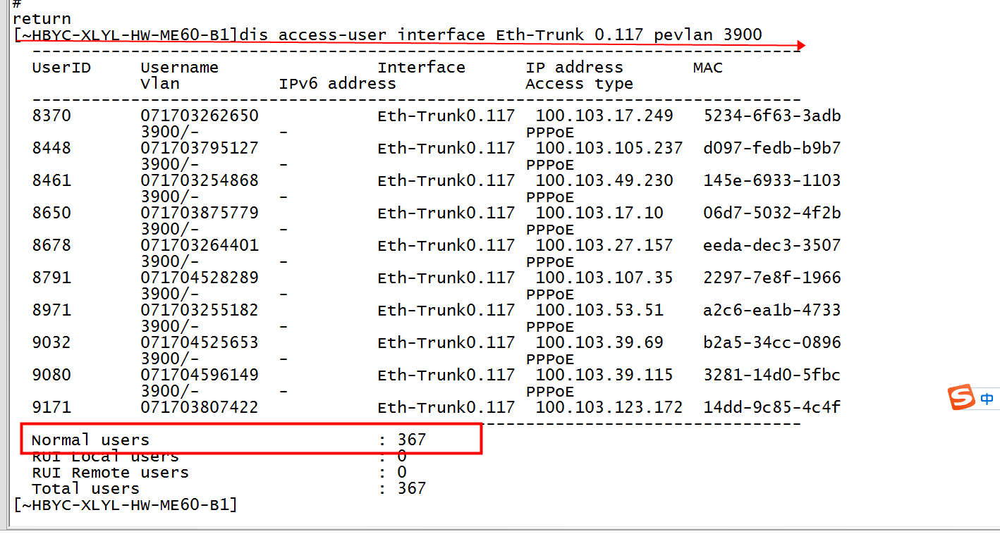

### 1.16 改变内标范围（内标错误检查）

1. 先看外标的数据做了没有：

```
show mac vlan xx
```

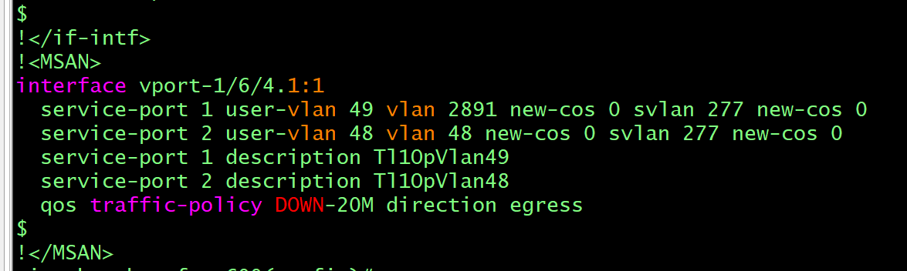

2. 若有别的 PON 口占用，回去检查 BAS 上的内外标范围：

```
display current-configuration | include <OLT的IP>
```

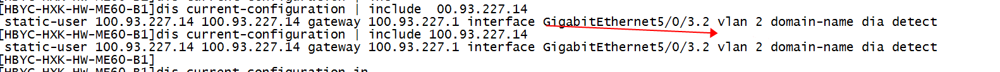

3. 找到对应子接口，看是不是 PPOE 口：

```
display interface description
```

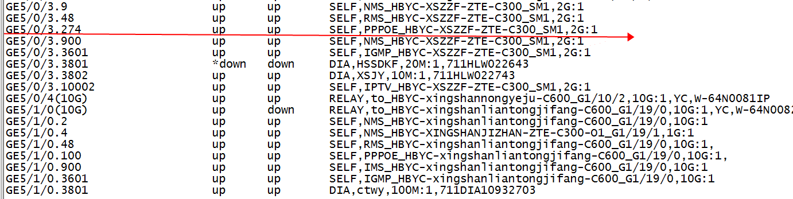

```
interface xxx
```

4. 若找不到 ppoe 子接口，可直接试写指令，看错误提示反推：


5. 若发现 BAS 上的内标范围不够（超范围），手动补一段：

```
user-vlan xxxx(起始) xxx(截止) qinq xxx xxx
```

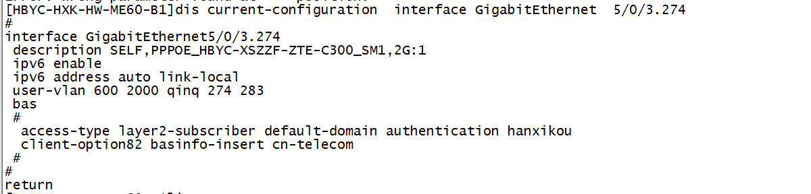
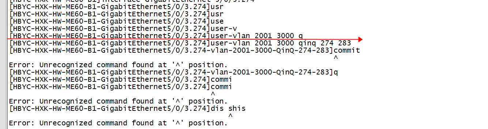

### 1.17 上联 950B 的 OLT 数据制作（IPRAN）

这类 OLT 不是直连 BAS，而是经 9306（IPRAN）上联。

1. 先确定对应 BAS，再找到对接的 **9306**；
2. 去 9306 上看子接口：

```
display current-configuration | include description
```

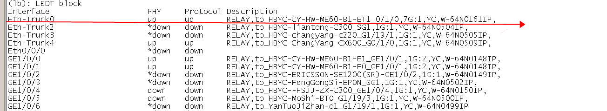

3. 发现子接口后回 BAS，此子接口应与 BAS 一一对应；
4. 看 BAS 上对应 Eth 口的 **`.48`** 子接口（网管/RMS）：

```
display current-configuration interface Eth-Trunk x.48
```

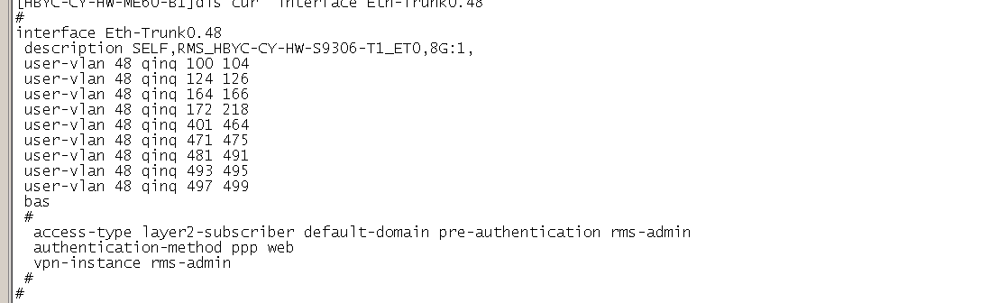

5. 确定未使用的外标（如 127-129 可用未新增），添加：

```
user-vlan 48 qinq xx xx
```

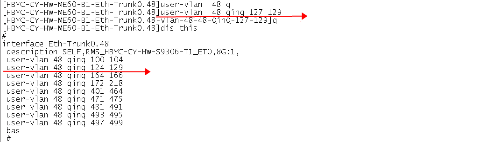

6. 再做 ppoe 子接口（宽带）：

```
interface Eth-Trunk0.112
 description SELF,PPPOE_HBYC-YL-HW-S9306-T1_ET1,20G:1,
 ipv6 enable
 ipv6 address auto link-local
 statistic enable
 user-vlan 1000 2000 qinq 112 115
 pppoe-server bind Virtual-Template 1
```

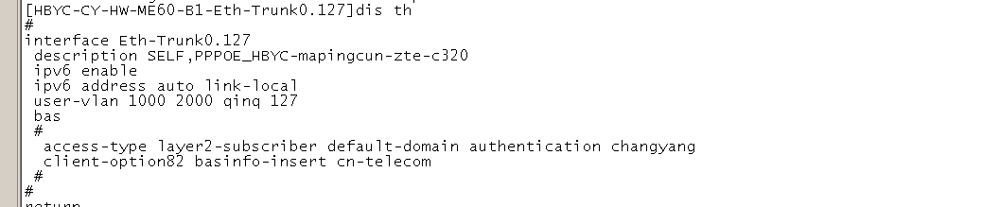

7. 再去做网管：

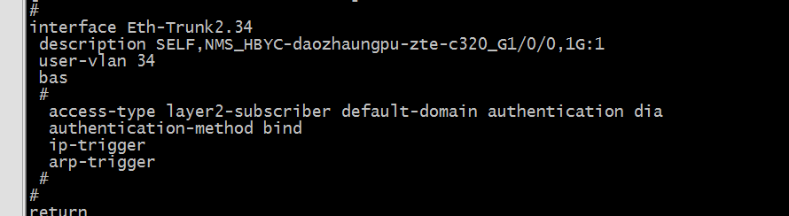

8. 再去绑定静态 IP：

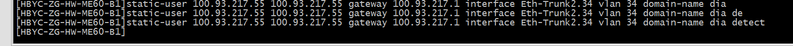

**注意**：走 950B 可以不用写组播。

**VLAN 穿透**：去 93 上把 vlan 穿透，传到 BAS 的同时，也要保证到 **CX600** 的 vlan 穿透，传输侧同样要是对应端口。

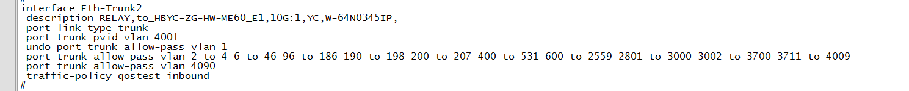
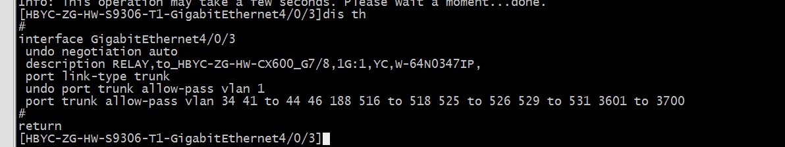

最后确认 vlan 起来了没有：

```
display vlan xx
```

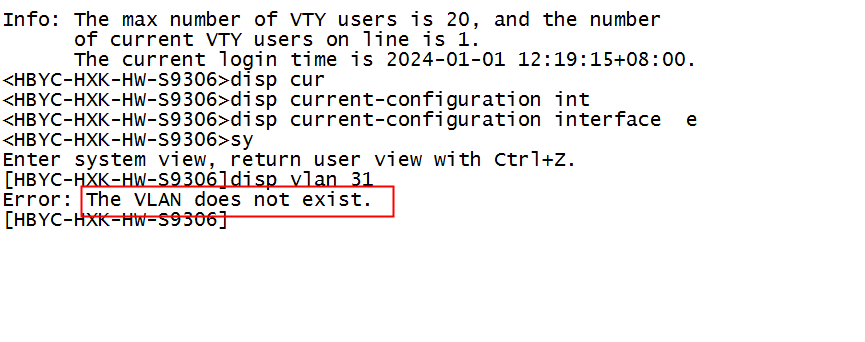

没起来就去 9306 上敲：

```
vlan xxx
```

### 1.18 上联是县乡波分的情况

**现象**（2024/1/14）：走县乡波分、宽带 vlan 时，ONU 获取不到宽带地址。

- 设备确实走的县乡波分；
- 宽带子接口也做了：


- 但 `.48` RMS 管理口里没数据：


**处理**：补一条

```
user-vlan 48 qinq 120
```

若修改后仍不通，注意中间还穿了一台 7800 交换机（两河）。

### 1.19 新加地址池

先看全局配置，找到对应名称的地址池（`domain xxxx`）：

```
display current-configuration
```


把需要添加的 IP 段加进去：

```
ip pool dia55 bas local
 gateway 122.190.251.97 255.255.255.240
 section 0 122.190.251.98 122.190.251.110
 excluded-ip-address 122.190.251.98 122.190.251.110
 dns-server 218.106.127.122 218.104.111.122
```

再进 AAA 域把地址池挂上：

```
aaa
 domain ims
  authentication-scheme none
  accounting-scheme none
  ip-pool ims
  ip-pool ims1
  ip-pool ims2
```


语音地址池还要带 vpn：

```
ip-pool imsx
 vpn-instance voice
```

### 1.20 查询 MAC 地址

用户报障时手里通常只有 MAC 或账号，先在 BAS 上按 MAC 找到人，再顺着端口往下查：

| 场景 | 命令 |
| --- | --- |
| 所有在线用户 | `display access-user` |
| 专线用户（domain dia） | `display access-user domain dia` |
| 按 MAC 查用户信息 | `display access-user mac-address 3485-112a-315c` |
| 查某端口下有没有用户 | `display access-user interface Eth-Trunk5.599` |
| 查接口全部 MAC 表（9306） | `display mac-address dynamic GigabitEthernet 1/0/19` |


### 1.21 其他问题

日常遇到的两类零散问题：网关地址要换、静态用户绑定条目太多想简化。

#### 网关在子接口上，如何修改地址池

1. 先关闭端口；
2. 删除原有 `ip address`：


3. 再按新地址正常添加。


#### 使用 interface-list 简化绑定

```
static-user interface-list olt-guanli
```


查看对应的 list：

```
display this        # 在对应视图下显示 list 内容
```

用 list 绑定：

```
static-user xxxx xxxx gateway xxx interface-list olt-guanli detect
```

---

## 第二章 IDC 设备（CE16808、中兴 9908）

### 2.1 IP 分配配置

1. 先看端口：

```
display current-configuration interface xxx xxx
```

2. 找到对应的 vlan，确认是不是客户名称；
3. 再看 vlanif：

```
display current-configuration interface vlanif x
```

4. 绑定静态 IP 路由：

```
ip route-static <初始IP> <终止IP> vlanif x
```

5. 开启 IPv4 出口允许：

```
ip ip-prefix YC-IDC-IPV4 permit 122.191.114.64 26
```

> **双机必做**：记得再去另一台 16808 设备上开启同一条命令。


### 2.2 关闭端口

先进口子，再 shutdown：

```
interface xxx
 shutdown
```


退出后如何确认确实关了？看接口状态：

```
show interface xgei-0/1/0/31
```


### 2.3 查看丢包与出口流量

判断 IDC 设备出口是否拥塞、链路是否健康，先看 ISIS 邻居状态，再看接口 CRC：

```
display isis peer
```


看 CRC 错误计数判断物理链路质量：


### 2.4 修改带宽

> 📌 原文此节只有标题、没有正文。IDC 侧的带宽调整同样通过 QoS 模板实现，具体参数写法参见 [3.7 修改专线带宽](#37-修改专线带宽) 与 [3.9 带宽模板](#39-带宽模板)。

### 2.5 中兴 9908

```
show isis ad
```


```
show interface xxx
```


---

## 第三章 互联网专线

### 3.1 确定 BAS 设备

**方法 A：NE5000 查询（推荐）**

在 BAS 的上联设备 NE5000 上敲：

```
display ip routing-table xxx.xxx.xxx.xxx
```


查到对应接口后，再看接口信息：

```
display current-configuration interface GigabitEthernet x/x/x
```


**方法 B：经验判断**

OLT 所在区域的 BAS 数量是固定的，一般都是就近接入。但**建议用 NE5000 查询，最为准确**。

### 3.2 在 BAS 上找到对应的子接口

```
display ip routing-table 100.93.224.5
```


在 BAS 上看它怎么联到 OLT。几种可能：

#### 情况一：子接口对应智网

先去找**最近的割接资料**里的外标信息：


先确定外标：


再确定内标（方式是找未使用的）。子接口如果是**专用的网管 vlan**：


看子接口使用情况：专线是 **3800-4000** 的范围，据此确定未使用的内标：


再进入在用的子接口，找到可用的外标：


#### 情况二：接 9306 的设备

先找到 93 对应的 BAS，再去对应的口子下穿透 vlan：


在 BAS 上先确定子接口（以 4008 子接口为例）：


配置专线子接口数据：


再去 93 上找到对应的子接口，穿透 vlan：


配置如下：

```
interface GigabitEthernet x/x/x
 description DIA,xxxxx:1,xxxxx
 port link-type access
 port default vlan xxxx
```

### 3.3 配置专线子接口

```
interface Eth-Trunk x.xxxx
 description DIA,xxxx(专线名称),xxM(带宽):1,xxx(专线号码)
 qos-profile xxM inbound identifier none
 qos-profile xxM outbound identifier none
 user-vlan xxx(内标) qinq xxx(外标)
 bas
  #
  access-type layer2-subscriber default-domain authentication dia
  authentication-method bind
  ip-trigger
  arp-trigger
```

### 3.4 绑定静态 IP

```
static-user dia,xxxx,xxm(接口描述):1,xxxx(专线号码) <起始IP> <终止IP> \
  gateway <网关> interface Eth-Trunkx.xx vlan xxxx qinq xxx domain-name dia detect
```

### 3.5 查询绑定 IP 情况

```
display current-configuration | include xxxx
```


### 3.6 针对 IPv6 绑定

```
interface Eth-Trunk5.30483806
 description DIA,sxdgl,70M:1,711DIA14313086
 ipv6 enable
 ipv6 address auto link-local
 qos-profile 70M inbound identifier none
 qos-profile 70M outbound identifier none
 user-vlan 3806 qinq 3048
 bas
  #
  access-type layer2-subscriber default-domain authentication dia
  authentication-method bind
  authentication-method-ipv6 bind
  ip-trigger
  arp-trigger
  ipv6-trigger
  nd-trigger
```

### 3.7 修改专线带宽

1. 先把原始数据**整段复制下来备份**；
2. 关掉端口（顺序很重要：先 shutdown，否则改不动 qos）：

```
interface xxx
 shutdown
 undo qos-profile inbound
 undo qos-profile outbound
 description DIA,jysc,100M:1,711DIA13835884
 qos-profile 200M inbound identifier none
 qos-profile 200M outbound identifier none
 commit
 display this          # 核对
 undo shutdown
```

### 3.8 删除子接口

前提：**保证 IP 已解绑、端口已关闭**。

```
undo interface Eth-Trunk5.30043800
```

### 3.9 带宽模板

```
qos-profile 200M
 car cir 204800 cbs 1870000 green pass red discard inbound
 car cir 204800 cbs 1870000 green pass red discard outbound
```

> `204800` = 200 × 1024（单位 kbps）。

---

## 第四章 OLT

### 4.1 登录方式与基础概念

**登录方式**：SecureCRT、Telnet、网管。

**Telnet 快速登录**：选择"快速链接"，协议选 Telnet，输入 IP 即可。


**账号**：

| 厂商 | 用户名 | 密码 |
| --- | --- | --- |
| 中兴 | `zte` | `<密码已隐藏>` |
| 华为 | `huawei` | `<密码已隐藏>` |

> **注意**：连续输错 3 次会进入锁定状态，无法登录。

**OLT 数据的四个要点**（看懂工单的前提）：

| 概念 | 说明 |
| --- | --- |
| LOID / SN | ONU 信息的索引，OLT 据此下发数据到对应 ONU |
| OLT 的 IP | OLT 的标识，可据此通过 telnet 远程访问 |
| PON 口 | 对应具体的物理接口 |
| 外层 VLAN（外标） | BAS 到 OLT 与传输之间的通道（描述不准确，大致这样理解） |
| 内层 VLAN（内标） | OLT 内区分相同外标的设备的标识 |


#### 华为 5800 / 5680T

**查看端口下已注册设备及配置**：

```
display current-configuration port 0/3/4
```

可以查看 0/3/4 这个 PON 口下全部 ONU 信息，通过显示的 LOID 或宽带账号找到对应的 ONT 编号。


**查看 ONU 配置**：

```
display current-configuration ont 0/2/1 1
```

**查看未注册 ONU**：

```
display ont autofind all
```

**查看 ONU 数据信息**（通过 LOID/SN 查 ONT 信息）：

```
display ont info by-loid T009063C0G0210000P
```


知道编号后：

```
display current-configuration ont xx x
```

即可看具体数据。

#### 中兴 C620 / C320

**查看 ONU 状态**：

```
show gpon onu state gpon-olt_1/2/1
```

**查看 ONU 数据配置**：

```
show running-config-interface gpon_onu-1/1/9:2
```


**查看端口下已注册设备信息**：

```
show running-config-interface gpon_olt-1/7/15
```


**通过 SN / LOID 查询**：

```
show gpon onu by sn
```


**LLDP**（找上联口，两种方式）：

```
show lldp entry interface xgei-x/x/x        # 方式 A：先进口子再点
show lldp internal                          # 方式 B
```

### 4.2 宽带上行模板（DBA）修改

**现象**：宽带测速上不去、上行不够，需要提高 ONU 的保证带宽/最大带宽。

**第 1 步：查看现状**

```
display current-configuration          # 看全局配置，知道对应 DBA 速率
```

```
display current-configuration ont xxxxx
```


```
display current-configuration
```


下拉找到对应的线路信息，关键词 `ont-lineprofile`：


上拉，在配置详情里找到 **DBA 模板**相关信息，看看上行的极限：


**参数含义**：

- `assure`：保证带宽，至少满足的带宽值；
- `max`：最大带宽值。

**第 2 步：修改或新建 DBA 模板**

修改已有 DBA 模板：

```
dba-profile modify profile-id x
```


新建 DBA 模板（保证 10M、最大 30M）：

```
dba-profile add type3 assure 10240 max 30720
```


**第 3 步：新建线路模板并改 DBA 引用**

> 关键原则：**不要直接改在用的线路模板**。先复制一份对应的模板，只改 DBA 引用，这样不会影响在用用户。

先找到 ONU 的线路模板信息：


新建模板（黄色部分要不重复，蓝色为名称）：

```
ont-lineprofile gpon profile-id 20 profile-name "ceshi"
 omcc encrypt off
 tcont 1 dba-profile-id 8               # 关键修改项：指向新的 DBA 模板
 gem add 1 eth tcont 1 encrypt off
 gem add 2 eth tcont 1 encrypt off
 gem add 3 eth tcont 1 encrypt off
 gem mapping 1 1 vlan 2000
 gem mapping 2 2 vlan 12
 gem mapping 3 1 vlan 3807
 gem mapping 3 3 vlan 3
 gem mapping 3 4 vlan 3815
 commit
 quit
```

> 以上语句都需要有空格才能写入。

**第 4 步：把 ONU 挂到新模板上**

进对应的 PON 口设置：

```
interface gpon 0/1
 ont modify x xx ont-lineprofile-id 11
```


### 4.3 新建线路模板（中兴）

```
profile tcont PCDN type 3 assured 10240 maximum 30720
tcont 1 name Tl1DefaultCreate profile PCDN
```


查看线路模板：

```
gpon
show this
```


### 4.4 故障处理流程

报障先分业务类型，不同业务查的点完全不同：宽带看在线状态和 vlan，语音看 service-port。按下面的顺序排，能最快定位到是线路、光路还是数据问题。

#### 4.4.1 宽带不通

**第 1 步：查 LOID 是否在线**

```
show gpon onu state gpon_olt-1/1/2
show gpon state gpon-olt_1/8/6
```


指令能看到 PON 口下设备的在线信息。**如果不在线，联系现场师傅重启设备**。

**第 2 步：在线后进设备配置界面，检查是不是外标 vlan 问题**

```
show mac vlan xxxx              # 中兴
display mac-address vlan xxx    # 华为
```

查 vlan 对应的 mac 是否存在。

#### 4.4.2 固话（语音）不通

**如果是已在使用的语音不通**，先查 ONU 状态，然后确认这行数据存在：

```
user-vlan 50 vlan 50 svlan xxx
```

常见原因：**svlan 对不上 IMS 业务的外标**。


需要修改该项：

```
interface gpon-onu_1/16/12:14
 no service-port 5
 service-port 5 vport 1 user-vlan 50 vlan 50 new-cos 5 svlan 900
 service-port 5 description Tl1OpVlan50
```

**第 3 步：ping 核心网验证**

固话测试 IP（核心网软交换服务器，**ping 通说明语音数据能送达核心网，接入层就没问题了**）：

```
100.47.1.53
```


**只要 ping 3 次都正常**，就可以去找交换侧排查。

### 4.5 修改 ONU 数据（中兴 C 系）

**找未注册设备**：

```
show gpon onu uncfg
```


**绑定 vlan、网口**：找到对应的 PON 口，进入 ONU 管理模式（以公司的 ONU 为例）：

```
pon-onu-mng gpon-onu_1/1/3:45
 server 1 gemport 1 vlan 3000
 server 2 gemport 1 vlan 1350
 vlan port eth_0/1 mode tag 1350
```


#### 特殊拨号上网的数据制作（vlan 599）

手动做数据，形态是把内标 `49`/`48` 映射到 `vlan 599`，共用一个外标 `svlan 543`：

```
interface vport-1/1/14.6:1
 service-port 1 user-vlan 49 vlan 599 new-cos 0 svlan 543 new-cos 0
 service-port 2 user-vlan 48 vlan 48 new-cos 0 svlan 543 new-cos 0
 service-port 2 description Tl1OpVlan48
 qos traffic-policy DOWN-20M direction egress
```


这种需要到相应 BAS 上把内外标都加上。

### 4.6 华为改 IPTV 外标

**先删掉原用户外标**：

```
igmp user delete smart-vlan 3686
```


**再添加智网外标**：

```
igmp user add smart-vlan 3621 no-auth
```


```
multicast-vlan 3601
igmp multicast-vlan member smart-vlan 3621
```


### 4.7 添加上联口外标

新开业务或割接后，OLT 上联口没有放行对应外标 vlan，业务就不通。做法是先确定上联口，再把这个 vlan 加进去。

#### 中兴

先看 LLDP 找到上联口，再进上联口（一般是 `smartgroup` 聚合口）添加 vlan tag：

```
interface smartgroup1
 switchport vlan 900 tag
```


加完用 `show this` 核对，能看到 `switchport vlan 2,521,900,2623 tag` 这种形态：

```
switchport mode hybrid
switchport vlan 2,521,900,2623 tag
switchport vlan 3260,3601 tag
```

#### 华为

直接在 config 模式下把 vlan 声明成 smart，再把 vlan 打到上联口：

```
vlan 2 smart
vlan 3601 smart
port vlan 2 0/10 0
port vlan 3601 0/10 0
```


### 4.8 查看光衰

ONU 掉线、频繁闪断时先看光功率：收光在 -8 到 -27 dBm 之间算正常，超出范围就是光路问题（脏、弯折、分光比过大）。

#### 中兴

C300：

```
show interface optical-module-info gei_1/3/1
```

C600：

```
show optical-module-info xgei-1/4/1
```


判读：**RX 是收光，TX 是发光**。

#### 华为

进 MPU 单板：

```
interface mpu x
display port ddm-info x
```


**华为 OLT 单 ONU 光衰**：

```
interface gpon 0/5
display ont optical-info 0 5
```

> 实拍截图见 [9.4 案例四](#94-案例四看华为-olt-的-onu-光衰)。

### 4.9 端口自适应速率


关闭端口速率自适应：

```
no negotiation auto
```

> 要**保证与传输那侧保持一致**。

### 4.10 查看端口错误包

怀疑物理链路有问题（丢包、协商异常）时，看端口的错误包计数：

```
display port statistics 0
```


### 4.11 链路聚合与相关协议

OLT 上联口带宽不够时要和交换机做链路聚合（LACP），做完还要在上联口启用 PPPoE、IPTV、组播几个代理协议，否则业务不通。不同型号的配置入口不一样，分开记。

#### 4.11.1 C620

需要将 OLT 添加 LACP 协议：

```
lacp
interface smartgroup1
```


智网的 LACP 协议模式选 802.3ad：

```
lacp mode 802.3ad
```


智网对应的子接口需要启动 LACP：

```
interface xx
smartgroup 1 mode active
```


**启动相关协议**：

添加 PPPoE：

```
pppoe-intermediate-agent vlan xxx
```


添加 IPTV：

```
dhcpv4-l2-relay-agent vlan xxx
```

添加 IGMP：

```
vlan x
igmp span-vlan
```


**检查**：

```
show lacp internal
```


如果为 `active`，说明 LACP 已激活。

> 再改完 BAS 后，正式接入智网。

**继续检查两代理**：

```
show pppoe-intermediate-agent vlan all
show dhcpv4-l2-relay-agent vlan all
```


**之后需要解绑 IGMP 的接口，替换为 sm1**：

```
show igmp mvlan 3601
```


此处注意两点：

1. 接口在**割接后需要为 `sm1`**；
2. 模式**必须为 v2** 才能组播。

```
igmp mvlan 3601
no source-port xgei-x/x/x
source-port smartgroup1
```


#### 4.11.2 C300

无论是智网上联还是 950B 上联，方式是一样的，但 **C300 起聚合的方式不同**：

`sm` 需要在口子设置 vlan 的同时添加协议。先进 interface、`sm1`：

```
smartgroup mode 802.3ad
```

再进 interface `xgexxx`：

```
smartgroup 1 mode active
```

**不用改 iptv 与 dhcp**，启动一下 igmp 就行了。指令是**先删单口**：

```
no igmp mvlan 3601 source-port gx/x/x
```

绑定智网聚合口：

```
igmp mvlan 3601 source-port sm1
```


发现写入之后，检查是否成功写入。

#### 4.11.3 C 系 OLT 清除全部 MAC 地址

割接后 MAC 表里还留着旧口学到的地址、导致流量走错口时，可以一次性清空整机动态 MAC 表让它重新学习：

```
mac delete all
```

#### 4.11.4 华为 MA5680T 设置链路聚合

在 MA5680T 配置模式下，通过 `link-aggregation` 设置链路聚合，聚合模式为 `lacp-static`，**对端交换机也要与该模式一致，否则协商不起来**。`0/19 0` 为主聚合口，`0/20 0` 为成员端口：

```
link-aggregation 0/19 0 0/20 0 egress-ingress workmode lacp-static
```

**如果设备上已存在聚合组，需要扩容聚合链路**（`0/19/0` 主聚合链路，`0/19 1` 为新扩容链路）：

```
link-aggregation add-member 0/19/0 0/19 1
```

**查询聚合模式**：

```
display link-aggregation all          # 查看该 OLT 所有聚合组
display link-aggregation 0/19/0       # 查看具体聚合组
```

返回示例：

```
link aggregation description: 0/19/01
link aggregation mode: egress-ingress
work mode:             lacp-static
max link number:       -
master port:           0/19/0
-------------------------------------------------------------------------
F/S                   Port List
-------------------------------------------------------------------------
0/19                  0,1
-------------------------------------------------------------------------
```

#### 4.11.5 华为 MA5800 设置链路聚合

把 9 槽位 0 端口与 10 槽位 0 端口设置成聚合组，主聚合口 `0/9/0`，工作模式 `lacp-static`，与交换机要一致：

```
link-aggregation 0/9 0 0/10 0 egress-ingress workmode lacp-static
```

已存在聚合组时要增加聚合端口：

```
link-aggregation add-member 0/9/0 0/9 1
```

**检查是否设置成功**：

```
display link-aggregation all          # 该 OLT 下所有聚合组
display link-aggregation 0/9/0        # 主端口为 0/9/0 的聚合组
```

返回示例：

```
Master    Link aggregation    Port  Work        Max          Least
port      mode                NUM   mode        link number  link number
-------------------------------------------------------------------------
0 /9 /0   egress-ingress         2  lacp-static           -            -
-------------------------------------------------------------------------
Total: 1 link aggregation(s)
```

```
link aggregation description: 0/9/0~1
link aggregation mode: egress-ingress
work mode:             lacp-static
max link number:       -
least link number:     -
master port:           0/9/0            # 聚合主端口
-------------------------------------------------------------------------
F/S                   Port List
-------------------------------------------------------------------------
0/9                   0,1
-------------------------------------------------------------------------
```

### 4.12 华为改上联口 VLAN

**透传 vlan**：

```
vlan xxx smart
```

**对固定的 vlan 需要 stacking**：

```
vlan attrib 123 stacking
```

**端口放行**：

```
port vlan xxx 0/x x
```


### 4.13 华为打开上联口

新开的上联口默认是 `shutdown` 状态，要进主控板（`mcu`）把它打开：

```
interface mcu 0/2
no shutdown
```


### 4.14 华为组播

**先关闭组播模式**：

```
igmp mode off
```


**再删掉之前的 vlan**：

```
undo igmp uplink-port 0/3/1
```

**添加新的 vlan**：

```
igmp uplink-port 0/3/1
```

**修改组播模式**：

```
igmp mode proxy
```


### 4.15 用户数据变更

割接或改业务时，经常要批量动一整片 ONU 的 vlan 和位置。网管上有现成的批量入口，比一台台敲命令快得多，下面三种是常用的。

#### 4.15.1 中兴修改 vlan（批量改 S-VID）

在网管左侧设备树上**右键 → 更多 → ONU 业务模板管理 → Service Port 网络侧 S-VID 批量修改**：


弹出批量修改窗口，选择**场景**：

| 选项 | 说明 |
| --- | --- |
| 位置 | `网元级别` / `PON口级别` |
| 条件 | `网络侧 S-VID` / `用户 VID` |


点**新建**，填转换规则：`网络侧 S-VID` 填**割接前**的 vlan，`修改后网络侧 S-VID` 填**割接后**的 vlan。


> 注意窗口下方提示：`网络侧 S-VID = (0-4094)`；`0` 表示没有配置网络侧 S-VID；多个 S-VID 用**逗号**分隔；支持范围输入（如 `1,3-8,16`）；前面加 `!` 表示**不包括**该 S-VID。

#### 4.15.2 迁移数据（PON 业务割接 / MacCut）

菜单位置：**维护 → PON 业务割接（MacCut）**：


打开后选 ONU 模式，通过左上"操作 → 增加源 PON 口 / 指定目的 PON 口"来配置割接：


在"指定目的 PON 口"里逐级点开 **EMS 服务器 → 地市 → 基站 → 板卡**，选板卡下的目的 PON 口：


窗口列表会显示每条割接的**迁移状态**（迁移成功 / 迁移失败）与待迁移 ONU 数，确认无误后点"开始"执行。

#### 4.15.3 telnet 设定（迁移失败时用 telnet）

迁移失败的网元，右键 → **修改网元**：


在"统一管理-修改"里切换到**命令行参数**页，协议选 **Telnet**，端口 `23`，填入用户名 `zte` 和密码后点"修改"：


#### 4.15.4 华为网管批量修改业务外标

1. 选择对应 OLT 的 ServicePort，点击查找：


2. 点击 VLAN ID 信息排序：


3. 选择要修改的外标 VLAN，右键选择"平移 VLAN ID"：


> VLAN ID 选择要平移的 VLAN。**注意原 VLAN 和新 VLAN 的属性必须一致，宽带和 IPTV 的 VLAN 属性必须为 `Stacking`**。

**PS**：如果外标修改失败，可以先手动改一个，让该外标对应的上联口获取到 MAC，再去网管改其余数据。

**IPTV 还需要设定 igmp**：先删 btv：


删除后在网管上修改，改完后再加上 btv：


### 4.16 新建网管对象（中兴）

在 EMS 设备树里，**右键地市/区县 → 新建对象 → 新建有线网元**：


在"统一管理-新建"里选择网元类型（PON OLT 产品下选具体型号，如 `C620`、`C600`、`C300`）：


填基本参数：网元名称、网元 IP、子网掩码；**读写团体名统一填 `YCLT_public`**，SNMP 版本选 `v3`，端口 `161`。


### 4.17 其他相关指令

平时零散用到、但不属于某一条业务流程的几条命令，集中放这里。

#### 4.17.1 C320 板卡启用万兆

```
show subcard
```

> `UCDC/3` 万兆口 `cfg` 模式为 **3** 才是万兆状态。


**先删**（`slotno` 对应的是板卡）：

```
del-subcard slotno 3 subcardno 1
```

确认：

```
Confirm to delete subcard? [yes/no]: y
```

**再添加**（以 `UCDC/3` 模式）：

```
add-subcard slotno 3 subcardno 1 UCDC/3
```

**确认是否识别成功**：

```
show subcard slotno 3
```

**查看同步状态**（主从数据同步，`ZXAN#` 即 `#` 模式下）：

```
show sync-status
```

文件同步：

```
file sync version
file sync package
file sync patch
file sync cfg-startup
```

#### 4.17.2 华为加载新板卡

```
display board 0
```


- `Failed` 表示板卡离线；
- `Auto find` 是待用状态：


**需要确认单板才能正常**：

```
board confirm 0
```


使对应的板子刷新出来，**变成 `normal` 才是正常**：


---

## 第五章 号线系统

号线系统是资源管理平台，用于修改 OLT 侧资源数据（PON 口 SVLAN、语音 IP 地址池等）。

### 5.1 修改号线 PON 口 VLAN（SVLAN）

1. 进入 UI 界面，找到"设备"一栏，选中**接入设备**：


2. 次选 **PON 局端设备（OLT）**，再选择相应的查询条件（比如设备的 IP 或者名称）：


3. 输入条件进行查询：


4. 继续点开细分选项（点击 `+`）：


5. 选到细分的板卡（例如 `2/7`），右键点击选项卡，选择"修改"：


6. **只针对 SVLAN 这一项进行修改**，看看与其他外标是否一致；如果不一致，按要求修改：


> ⚠️ **其他选项，如果没要求千万别动！**

### 5.2 修改号线语音 IP

1. 在"码号"里找到 **IP 地址池**：


2. 右键新增：


3. 输入对应 OLT 名称：


4. 更改 IP 对应地址：


---

## 第六章 账号与网站汇总

> 以下地址多为内网/专网地址，需在对应网络环境下访问。

### 6.1 宽带用户变更明细

**平台路径**：湖北联通网络数据应用平台 → 承载网 → 日报 → 宽带用户变更明细。

数据按**地市、日期**先查询，再输出 Excel。

```
http://10.19.100.122:8296/WebReport/ReportServer?op=fs
```

账号：`hb-penglf` / `<密码已隐藏>`


### 6.2 测速平台（需内网）

```
http://cesu.hb.cnc.cn:8090/sts/index/toLoginPage.action
```


**WIFI 测速**（另一个入口）：

```
http://cesu.hb.cnc.cn:8090/sts/
```

账号：`yc_kdcs` / `<密码已隐藏>`

### 6.3 公众平台（需 IE8 / 360 浏览器）

```
http://58.19.117.122:7003/IOMPROJ/
http://10.19.100.172:8080/IOMPROJ/logon.jsp
```

公众支撑系统账号：`YC-ZWDD07` / `<密码已隐藏>`

### 6.4 号线系统

```
http://10.19.100.113:10010/resource/home
```

| 用户名 | 密码 |
| --- | --- |
| `Yang.zhijiang` | `<密码已隐藏>` |
| `Hu.lingyun` | `<密码已隐藏>` |

### 6.5 账号速查表

| 系统 | 地址 | 账号 / 密码 |
| --- | --- | --- |
| 宽带用户变更明细 | `http://10.19.100.122:8296/WebReport/ReportServer?op=fs` | `hb-penglf` / `<密码已隐藏>` |
| 测速平台 | `http://cesu.hb.cnc.cn:8090/sts/index/toLoginPage.action` | — |
| WIFI 测速 | `http://cesu.hb.cnc.cn:8090/sts/` | `yc_kdcs` / `<密码已隐藏>` |
| 公众平台 | `http://58.19.117.122:7003/IOMPROJ/`<br>`http://10.19.100.172:8080/IOMPROJ/logon.jsp` | `YC-ZWDD07` / `<密码已隐藏>` |
| 号线系统 | `http://10.19.100.113:10010/resource/home` | `Yang.zhijiang` / `<密码已隐藏>`<br>`Hu.lingyun` / `<密码已隐藏>` |
| IP 备案 | `https://beian.wo.cn:8081/filingweb/filing/login/reLogin` | `ycpenglinfan` / `<密码已隐藏>` |
| 中兴 OLT | Telnet | `zte` / `<密码已隐藏>` |
| 华为 OLT | Telnet | `huawei` / `<密码已隐藏>` |
| 网管对象（中兴） | — | 读写团体名 `YCLT_public` |

---

## 第七章 Python 与 Pandas 速查

> Pandas 是利用 Python 进行数据分析、表格制作的一个工具。以下按"读文件 → 查看 → 操作 → 导出"的顺序整理。

### 7.1 读文件

```python
# 建立 ExcelFile 对象后可按 sheet 名读取
df1 = pd.ExcelFile(cdir1 + "\\" + file1)

# 读第一个 sheet
df = pd.read_excel(cdirx + "\\" + file)

# 读指定名称的 sheet
df1 = pd.read_excel(cdir1 + "\\" + file1, sheet_name='融合明细')

# 跳过前 x 行再读
df = pd.read_excel(xxxx, skiprows=x)

# 读 csv（中文用 gbk）
df = pd.read_csv(cdir1 + "\\" + file1, encoding='gbk')
```

**批量读多个表并合并成一个表**：

```python
for filename in glob.glob(cdir1 + r'\*.xls'):
    df_ = pd.read_excel(filename, skiprows=1)
    print('导入文件名:', filename, '用户数:', df_.shape[0])
    df_["fn"] = filename
    df_list.append(df_)
    del df_
df = pd.concat(df_list)          # 组合多个表格形成测速平台全量表
```

### 7.2 查看表格相关信息

拿到一张表先别急着处理，用这几条把规模、列名、取值分布看一眼，才知道后面该怎么清洗：

| 命令 | 作用 |
| --- | --- |
| `df1.info()` | 查看表格相关信息（列类型、非空数） |
| `df.head()` | 查看前几行 |
| `df.tail()` | 查看后几行 |
| `df.shape` | 查看表格有几行几列 |
| `df.columns` | 查看列名/列数据类型 |
| `df['xxx'].unique()` | 查看列名为 xxx 的元素种类 |
| `df['x'].value_counts()` | 查看列元素数量（频次） |


### 7.3 表格操作指令

**删除空值**（对整行含 nan 的删除，生成新表，原表不变）：

```python
df01 = df1.dropna()
```

**去重**：

```python
df.drop_duplicates(keep='first', inplace=True)
# keep 为保留项；inplace=True 表示在原表上修改
```

**取表中几列组成新表**：

```python
df1 = df[['xxx', 'xxx', 'xxxx']]
```

**筛选特定条件的值**：

```python
df[(df['x'] == 'xxxx')]

# 例子：筛选接入方式为 FTTH 且业务号码不为某值的行
df3[(df3['接入方式'] == 'FTTH') & (df3['业务号码'] != '071704433964')]
```

**改列名**：

```python
df.columns = ['xxxxx']        # 注意：新列名列表长度要与原列数一致
```

**过滤特定字符串**：

```python
df1 = df[df["x"].str.contains("xxxx")]

# 例子：只保留产品名含 300 / 500 / 1000 的行（即过滤掉其他）
df3 = df2[(df2["PRODUCT_NAME"].str.contains("300")) |
          (df2["PRODUCT_NAME"].str.contains("500")) |
          (df2["PRODUCT_NAME"].str.contains("1000"))]
```

**列数据添加字符串前缀**：

```python
df['x'] = 'xxxx' + df['x'].astype(str)      # astype(str) 使列变为字符串

# 例子：业务号码统一加前导 0
df01['业务号码'] = '0' + df01['业务号码'].astype(str)
```

**找出唯一值**：

```python
value = df['x'].unique()          # 取 df 中 x 的数值成为一个数组
```


**判断是否在另一个集合中存在（isin）**：

```python
df1 = df[df['x'].isin(xxxx)]      # df 中 x 列的数据是否在 xxxx 中存在

# 例子：用 df01 的业务号码做白名单，筛出 df02 中命中的行
value1 = df01['业务号码'].unique()
df3 = df02[df02['业务号码'].isin(value1)]
```

**拼接表格**：

```python
pd.merge(df左边, df右边, how='left', on='xxxx')

# 例子：以左边表为主，按 OLT地址 列拼接
df42 = pd.merge(df41, df1, how='left', on='OLT地址')
```

> `how='left'` 以左表为准。

**替换字符串**：

```python
df01['业务号码'] = df01['业务号码'].astype(str).str.replace('0717', '717')
```

**引用数据（VLOOKUP 效果）**：

```python
# 假设 df1 和 df2 是两个表，通过某一列将 df2 的数据引用到 df1 中
df1['新列名'] = df1['共同列名'].map(df2.set_index('共同列名')['目标列名'])
```

### 7.4 常用代码

**导出文件**：

```python
daynow = datetime.datetime.now()
ymd1 = daynow.strftime('%Y%m%d%H%M%S')
filew = "xxxx" + ymd1 + ".xlsx"          # xxxx 为导出表名，ymd1 为时间标签
print('\n导出结果文件名称\n', filew)
dfxxxx.to_excel(filew, index=False)      # dfxxxx 为要导出的 DataFrame
```


**读文件前的标准导入头与设置**：

```python
%%time
import numpy as np
import pandas as pd
import datetime
import time
import os
import glob
from warnings import simplefilter
simplefilter(action='ignore', category=FutureWarning)
pd.set_option('display.float_format', lambda x: '%.3f' % x)
df_list = []
```

**常用变量定义**：

```python
cdir1 = r"xxx/xxx/xxx/"      # 定义目录
file1 = "xxxx"               # 定义文件
```

```
pwd                          # 看程序当前目录
```


---

## 第八章 IP 备案

### 8.1 系统与要求

中国联通网站备案管理系统：

```
https://beian.wo.cn:8081/filingweb/filing/login/reLogin
```

- 用户名：`ycpenglinfan`
- 密码：`<密码已隐藏>`

> ⏰ **备案要求：新分 IP 使用后 5 个工作日内必须备案。**

### 8.2 流程一：单位信息录入

先查询单位是否已录入，**若已录入则省略该步骤**。以下以 `122.191.251.147` 为例。

1. IP 备案查询：


2. 备案维护 → IP 使用单位：


3. 根据钉钉开通工单里客户经理提供的客户信息表，填写录入单位信息：


### 8.3 流程二：IP 分配查询

1. 备案查询 → IP 分配情况查询 → 起始 IP 地址 → 查询：


2. `122.191.251.147` 段已预留，需从预留段剔除出去：


3. 剔除后，`122.191.251.148` — `122.191.251.255` 段预留备案：


4. 对 `122.191.251.147` 分配且使用备案：


---

## 第九章 实际配置案例

### 9.1 案例一：语音地址池加 IP 段

**背景**：语音地址池不够用，需要在既有 BAS 上新增一段语音 IP。

**第 1 步**：`display current-configuration` 看一下全局配置：


**第 2 步**：去找一下没启用的最新地址池名称。本案例新增 `100.51.168.2-30` 这一段。

**第 3 步**：新加语音地址池：

```
ip pool ims11 bas local
 vpn-instance voice
 gateway 100.51.168.1 255.255.255.0
 section 0 100.51.168.2 100.51.168.254
 excluded-ip-address 100.51.168.2 100.51.168.254
```

**第 4 步**：创建/进入名叫 `ims` 的 AAA 域，把池挂上：

```
aaa
 domain ims
  ip-pool ims11
```

**第 5 步**：批量配置静态 IPoE 用户：

```
static-user 100.51.168.2 100.51.168.30 gateway 100.51.168.1 \
  vpn-instance voice interface Eth-Trunk5.900 vlan 50 qinq 900 domain-name ims detect
```

### 9.2 案例二：删除 C600 系列的 LACP 聚合组员

**去除聚合组**：

```
lacp
 interface xgei-1/5/1
  no smartgroup
```

**进入具体上联口删除具体 vlan**：

```
interface xgei-1/5/1
 no switchport vlan 57,125,233-234
 no switchport vlan 3019,3601,3627
 no switchport vlan 3647
```

### 9.3 案例三：改 C300 的组播

先看现状：

```
show igmp mvlan 3601
```

```
-------------------------------------------------------------------------------
Source Port        HostCompatibleMode   HostConfigMode   V1TimeOut   V2TimeOut
-------------------------------------------------------------------------------
sg1                   v3                   auto              0           0
```

删除旧的 source-port（原绑定在 `smartgroup1`）：

```
no igmp mvlan 3601 source-port smartgroup1
```

绑定新的口（改成 `xgei_1/3/2`）：

```
igmp mvlan 3601 source-port xgei_1/3/2
```

验证：

```
show mac vlan 3601
```

```
Total mac address : 1

Mac address      Vlan  Type      Port                     Vc
-------------------------------------------------------------------------------
b885.7be6.b562   3601  Dynamic   xgei_1/3/2
```

### 9.4 案例四：看华为 OLT 的 ONU 光衰

```
interface gpon 0/5
display ont optical-info 0 5
```


### 9.5 宽带拉流数据制作（完整配置）

以 `HBYC-YDtoubishequ-ZTE-C600-O1` 为例。

**1）配置聚合口**：

```
interface Eth-Trunk6
 description RELAY,to_HBYC-YDtoubishequ-ZTE-C600-O1_SM1,20G:1,YC,W-64N0057IP
 mode lacp-static
 nas logic-port eth-Trunk 4/1/3
```


**2）配置 RMS 认证（`.48` 子接口）**：

```
interface Eth-Trunk6.48
 description SELF,RMS_HBYC-YDtoubishequ-ZTE-C600-O1_SM1,20G:1
 user-vlan 48 qinq 999
 bas
  #
  access-type layer2-subscriber default-domain pre-authentication rms-admin
  authentication-method ppp web
  vpn-instance rms-admin
  #
```

**3）配置 PPPoE（`.100` 子接口）**：

```
interface Eth-Trunk6.100
 description SELF,PPPOE_HBYC-YDtoubishequ-ZTE-C600-O1_SM1,20G:1
 ipv6 enable
 ipv6 address auto link-local
 user-vlan 1000 2000 qinq 999
 bas
  #
  access-type layer2-subscriber default-domain authentication yidu-gongwang
  client-option82 basinfo-insert cn-telecom
  #
```

---

## 附录：常用命令速查

下面按设备类型把常用命令集中列出来，排障时直接查表，不用翻正文。

### BAS（华为 NE 系列）

| 用途 | 命令 |
| --- | --- |
| 查路由 | `display ip routing-table x.x.x.x` |
| 查接口描述 | `display interface description` |
| 查子接口配置 | `display current-configuration interface Eth-Trunk x.x` |
| 按 IP 搜配置 | `display current-configuration \| include x.x.x.x` |
| 查在线用户 | `display access-user` |
| 按 MAC 查用户 | `display access-user mac-address xxxx-xxxx-xxxx` |
| 查端口下用户 | `display access-user interface Eth-Trunk x.x pevlan x` |
| 踢在线用户 | `cut access-user ip-address x.x.x.x` |
| 接口简报 | `display interface brief` |
| 进管理模式 | `system`（提示符 `<>` → `[]`） |
| 提交 | `commit` |
| 保存 | `save` |

### 中兴 OLT（C300 / C600 / C620 / C320）

| 用途 | 命令 |
| --- | --- |
| ONU 状态 | `show gpon onu state gpon-olt_x/x/x` |
| ONU 配置 | `show running-config-interface gpon_onu-x/x/x:x` |
| 端口已注册设备 | `show running-config-interface gpon_olt-x/x/x` |
| 按 SN/LOID 查 | `show gpon onu by sn` |
| 未配置 ONU | `show gpon onu uncfg` |
| ONU 管理 | `pon-onu-mng gpon-onu_x/x/x:x` |
| LLDP | `show lldp entry interface xgei-x/x/x` / `show lldp internal` |
| 查 MAC | `show mac vlan xx` |
| 光衰（C300） | `show interface optical-module-info gei_x/x/x` |
| 光衰（C600） | `show optical-module-info xgei-x/x/x` |
| 清 MAC | `mac delete all` |
| LACP 检查 | `show lacp internal` |
| PPOE 代理 | `show pppoe-intermediate-agent vlan all` |
| DHCP 代理 | `show dhcpv4-l2-relay-agent vlan all` |
| 组播 | `show igmp mvlan 3601` |
| 板卡 | `show subcard` |
| 同步状态 | `show sync-status` |
| 文件同步 | `file sync version/package/patch/cfg-startup` |

### 华为 OLT（MA5680T / MA5800）

| 用途 | 命令 |
| --- | --- |
| 端口下 ONU | `display current-configuration port 0/3/4` |
| ONU 配置 | `display current-configuration ont 0/2/1 1` |
| 未注册 ONU | `display ont autofind all` |
| 按 LOID 查 | `display ont info by-loid xxx` |
| 查 MAC | `display mac-address vlan xxx` |
| 光衰（板卡） | `display port ddm-info x` |
| 光衰（ONU） | `display ont optical-info 0 5` |
| 端口错包 | `display port statistics 0` |
| 链路聚合 | `display link-aggregation all` |
| 板卡状态 | `display board 0` |
| 确认单板 | `board confirm 0` |
| 组播 | `igmp mode off/proxy`、`igmp uplink-port 0/3/1` |

### IDC（CE16808、中兴 9908）

| 用途 | 命令 |
| --- | --- |
| 端口配置 | `display current-configuration interface xxx` |
| vlanif 配置 | `display current-configuration interface vlanif x` |
| 接口状态 | `show interface xgei-0/1/0/31` |
| isis 邻居 | `display isis peer` / 中兴 `show isis ad` |
| 路由绑定 | `ip route-static <起> <止> vlanif x` |
| IPv4 出口 | `ip ip-prefix YC-IDC-IPV4 permit 122.191.114.64 26` |
